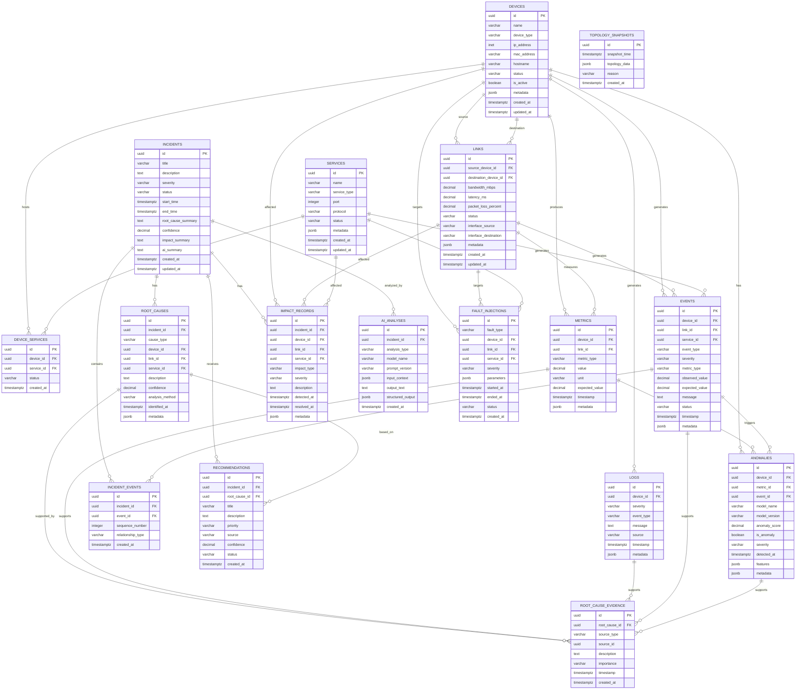

# NetRCA — Entity Relationship Diagram (ERD)

## 1. Purpose

This document defines the relational data model for **NetRCA — AI-Powered Network Root Cause Analysis and Incident Response System**.

The database is designed for **Supabase/PostgreSQL** and stores the network topology, devices, links, metrics, logs, events, anomalies, incidents, root-cause findings, evidence, impact analysis, recommendations, fault injections, and AI-generated analysis.

The model supports the complete NetRCA pipeline:

```text
NETWORK
   ↓
METRICS / LOGS / EVENTS
   ↓
ANOMALIES
   ↓
EVENT CORRELATION
   ↓
INCIDENT
   ↓
ROOT CAUSE
   ↓
EVIDENCE
   ↓
IMPACT
   ↓
AI EXPLANATION
   ↓
RECOMMENDATION
```

---

# 2. Database Technology

- **Database:** PostgreSQL
- **Platform:** Supabase
- **Primary Keys:** UUID
- **Timestamps:** `TIMESTAMPTZ`
- **Flexible metadata:** `JSONB`
- **Enumerated states:** PostgreSQL ENUMs or constrained text values
- **Foreign Keys:** Used for referential integrity
- **Indexes:** Required on timestamps, foreign keys, device IDs, incident IDs, and frequently filtered fields

---

# 3. Entity Overview

The core entities are:

```text
devices
links
metrics
logs
events
anomalies
incidents
incident_events
root_causes
root_cause_evidence
impact_records
recommendations
fault_injections
ai_analyses
```

Supporting entities:

```text
services
device_services
topology_snapshots
```

---

# 4. High-Level ERD

```text
                         ┌──────────────────┐
                         │     DEVICES      │
                         └───────┬──────────┘
                                 │
              ┌──────────────────┼──────────────────┐
              │                  │                  │
              ▼                  ▼                  ▼
        ┌───────────┐      ┌───────────┐      ┌───────────┐
        │  METRICS  │      │   LOGS    │      │  EVENTS   │
        └─────┬─────┘      └─────┬─────┘      └─────┬─────┘
              │                  │                  │
              │                  │                  ▼
              │                  │            ┌─────────────┐
              │                  └───────────► │  ANOMALIES  │
              │                               └──────┬──────┘
              │                                      │
              │                                      ▼
              │                              ┌────────────────┐
              └────────────────────────────► │   INCIDENTS    │
                                             └───────┬────────┘
                                                     │
                         ┌───────────────────────────┼─────────────────────────┐
                         │                           │                         │
                         ▼                           ▼                         ▼
                 ┌──────────────┐          ┌────────────────┐       ┌────────────────┐
                 │ ROOT_CAUSES  │          │ IMPACT_RECORDS │       │ AI_ANALYSES    │
                 └───────┬──────┘          └────────────────┘       └────────────────┘
                         │
                         ▼
                 ┌────────────────────┐
                 │ ROOT_CAUSE_EVIDENCE│
                 └────────────────────┘
                         │
                         ├──────────► METRICS
                         ├──────────► LOGS
                         ├──────────► EVENTS
                         └──────────► ANOMALIES

 DEVICES ◄────────────── LINKS
    │
    └──────────────► DEVICE_SERVICES ◄────────────── SERVICES

 FAULT_INJECTIONS ─────────────► DEVICES / LINKS
```

---

# 5. Entity: `devices`

Stores all simulated network components.

## Fields

| Field | Type | Constraints | Description |
|---|---|---|---|
| `id` | UUID | PK | Unique device ID |
| `name` | VARCHAR | NOT NULL | Device name, e.g. R1 |
| `device_type` | VARCHAR | NOT NULL | Router, switch, server, host, DNS |
| `ip_address` | INET | NULL | Device IP address |
| `mac_address` | VARCHAR | NULL | MAC address |
| `hostname` | VARCHAR | NULL | Hostname |
| `status` | VARCHAR | NOT NULL | HEALTHY, WARNING, DOWN |
| `is_active` | BOOLEAN | DEFAULT TRUE | Whether device is active |
| `metadata` | JSONB | NULL | Additional device information |
| `created_at` | TIMESTAMPTZ | NOT NULL | Creation time |
| `updated_at` | TIMESTAMPTZ | NOT NULL | Last update |

## Device Types

```text
ROUTER
SWITCH
SERVER
HOST
DNS
```

## Relationships

```text
devices 1 ──── N metrics
devices 1 ──── N logs
devices 1 ──── N events
devices 1 ──── N anomalies
devices 1 ──── N fault_injections
```

---

# 6. Entity: `links`

Stores network connections between devices.

## Fields

| Field | Type | Constraints | Description |
|---|---|---|---|
| `id` | UUID | PK | Unique link ID |
| `source_device_id` | UUID | FK → devices.id | Source device |
| `destination_device_id` | UUID | FK → devices.id | Destination device |
| `bandwidth_mbps` | DECIMAL | NULL | Configured bandwidth |
| `latency_ms` | DECIMAL | NULL | Configured latency |
| `packet_loss_percent` | DECIMAL | NULL | Configured packet loss |
| `status` | VARCHAR | NOT NULL | UP, DEGRADED, DOWN |
| `interface_source` | VARCHAR | NULL | Source interface |
| `interface_destination` | VARCHAR | NULL | Destination interface |
| `metadata` | JSONB | NULL | Additional information |
| `created_at` | TIMESTAMPTZ | NOT NULL | Creation time |
| `updated_at` | TIMESTAMPTZ | NOT NULL | Last update |

## Relationships

```text
devices 1 ──── N links (source)
devices 1 ──── N links (destination)

links 1 ──── N metrics
links 1 ──── N events
links 1 ──── N fault_injections
```

---

# 7. Entity: `services`

Represents services running on network devices.

Examples:

```text
DNS
Web Server
API Server
Database Server
```

## Fields

| Field | Type | Constraints | Description |
|---|---|---|---|
| `id` | UUID | PK | Service ID |
| `name` | VARCHAR | NOT NULL | Service name |
| `service_type` | VARCHAR | NOT NULL | DNS, HTTP, API, etc. |
| `port` | INTEGER | NULL | Service port |
| `protocol` | VARCHAR | NULL | TCP, UDP, etc. |
| `status` | VARCHAR | NOT NULL | UP, DEGRADED, DOWN |
| `metadata` | JSONB | NULL | Service metadata |
| `created_at` | TIMESTAMPTZ | NOT NULL | Creation time |
| `updated_at` | TIMESTAMPTZ | NOT NULL | Last update |

---

# 8. Entity: `device_services`

Many-to-many relationship between devices and services.

## Fields

| Field | Type | Constraints |
|---|---|---|
| `id` | UUID | PK |
| `device_id` | UUID | FK → devices.id |
| `service_id` | UUID | FK → services.id |
| `status` | VARCHAR | NOT NULL |
| `created_at` | TIMESTAMPTZ | NOT NULL |

## Relationship

```text
devices N ──── N services
       │
       └── device_services
```

---

# 9. Entity: `metrics`

Stores time-series network measurements.

## Fields

| Field | Type | Constraints | Description |
|---|---|---|---|
| `id` | UUID | PK | Metric ID |
| `device_id` | UUID | FK → devices.id | Device |
| `link_id` | UUID | FK → links.id, NULL | Optional link |
| `metric_type` | VARCHAR | NOT NULL | Metric type |
| `value` | DECIMAL | NOT NULL | Measured value |
| `unit` | VARCHAR | NULL | ms, %, Mbps, etc. |
| `expected_value` | DECIMAL | NULL | Expected baseline |
| `timestamp` | TIMESTAMPTZ | NOT NULL | Measurement time |
| `metadata` | JSONB | NULL | Additional values |

## Metric Types

```text
LATENCY
PACKET_LOSS
BANDWIDTH
THROUGHPUT
CPU
MEMORY
ERROR_RATE
AVAILABILITY
```

## Relationships

```text
devices 1 ──── N metrics
links 1 ──── N metrics
metrics 1 ──── N root_cause_evidence
```

---

# 10. Entity: `logs`

Stores network and system logs.

## Fields

| Field | Type | Constraints |
|---|---|---|
| `id` | UUID | PK |
| `device_id` | UUID | FK → devices.id |
| `severity` | VARCHAR | NOT NULL |
| `event_type` | VARCHAR | NULL |
| `message` | TEXT | NOT NULL |
| `source` | VARCHAR | NULL |
| `timestamp` | TIMESTAMPTZ | NOT NULL |
| `metadata` | JSONB | NULL |

## Severity

```text
INFO
WARNING
ERROR
CRITICAL
```

## Relationships

```text
devices 1 ──── N logs
logs 1 ──── N root_cause_evidence
```

---

# 11. Entity: `events`

Stores structured events generated from metrics, logs, or network state changes.

## Fields

| Field | Type | Constraints |
|---|---|---|
| `id` | UUID | PK |
| `device_id` | UUID | FK → devices.id, NULL |
| `link_id` | UUID | FK → links.id, NULL |
| `service_id` | UUID | FK → services.id, NULL |
| `event_type` | VARCHAR | NOT NULL |
| `severity` | VARCHAR | NOT NULL |
| `metric_type` | VARCHAR | NULL |
| `observed_value` | DECIMAL | NULL |
| `expected_value` | DECIMAL | NULL |
| `message` | TEXT | NULL |
| `status` | VARCHAR | NOT NULL |
| `timestamp` | TIMESTAMPTZ | NOT NULL |
| `metadata` | JSONB | NULL |

## Event Types

```text
ROUTER_FAILURE
INTERFACE_FAILURE
SWITCH_FAILURE
LINK_FAILURE
PACKET_LOSS
HIGH_LATENCY
NETWORK_CONGESTION
DNS_FAILURE
SERVER_TIMEOUT
SERVER_OVERLOAD
DEVICE_UNAVAILABLE
SERVICE_FAILURE
HIGH_ERROR_RATE
```

---

# 12. Entity: `anomalies`

Stores ML-based anomaly detection results.

## Fields

| Field | Type | Constraints |
|---|---|---|
| `id` | UUID | PK |
| `device_id` | UUID | FK → devices.id, NULL |
| `metric_id` | UUID | FK → metrics.id, NULL |
| `event_id` | UUID | FK → events.id, NULL |
| `model_name` | VARCHAR | NOT NULL |
| `model_version` | VARCHAR | NULL |
| `anomaly_score` | DECIMAL | NOT NULL |
| `is_anomaly` | BOOLEAN | NOT NULL |
| `severity` | VARCHAR | NOT NULL |
| `detected_at` | TIMESTAMPTZ | NOT NULL |
| `features` | JSONB | NULL |
| `metadata` | JSONB | NULL |

## Example

```text
Model: Isolation Forest
Metric: packet_loss
Value: 24%
Anomaly Score: 0.91
Is Anomaly: TRUE
Severity: CRITICAL
```

## Relationships

```text
devices 1 ──── N anomalies
metrics 1 ──── N anomalies
events 1 ──── N anomalies
anomalies 1 ──── N root_cause_evidence
```

---

# 13. Entity: `incidents`

Represents a complete network problem investigated by NetRCA.

## Fields

| Field | Type | Constraints |
|---|---|---|
| `id` | UUID | PK |
| `title` | VARCHAR | NOT NULL |
| `description` | TEXT | NULL |
| `severity` | VARCHAR | NOT NULL |
| `status` | VARCHAR | NOT NULL |
| `start_time` | TIMESTAMPTZ | NOT NULL |
| `end_time` | TIMESTAMPTZ | NULL |
| `root_cause_summary` | TEXT | NULL |
| `confidence` | DECIMAL | NULL |
| `impact_summary` | TEXT | NULL |
| `ai_summary` | TEXT | NULL |
| `created_at` | TIMESTAMPTZ | NOT NULL |
| `updated_at` | TIMESTAMPTZ | NOT NULL |

## Incident Status

```text
DETECTED
INVESTIGATING
ROOT_CAUSE_IDENTIFIED
RESOLVED
CLOSED
```

## Severity

```text
LOW
MEDIUM
HIGH
CRITICAL
```

---

# 14. Entity: `incident_events`

Associates events with incidents.

This is important because one incident can contain many events.

## Fields

| Field | Type | Constraints |
|---|---|---|
| `id` | UUID | PK |
| `incident_id` | UUID | FK → incidents.id |
| `event_id` | UUID | FK → events.id |
| `sequence_number` | INTEGER | NOT NULL |
| `relationship_type` | VARCHAR | NULL |
| `created_at` | TIMESTAMPTZ | NOT NULL |

## Relationship

```text
incidents N ──── N events
       │
       └── incident_events
```

---

# 15. Entity: `root_causes`

Stores the RCA engine's root-cause finding.

## Fields

| Field | Type | Constraints |
|---|---|---|
| `id` | UUID | PK |
| `incident_id` | UUID | FK → incidents.id |
| `cause_type` | VARCHAR | NOT NULL |
| `device_id` | UUID | FK → devices.id, NULL |
| `link_id` | UUID | FK → links.id, NULL |
| `service_id` | UUID | FK → services.id, NULL |
| `description` | TEXT | NOT NULL |
| `confidence` | DECIMAL | NOT NULL |
| `analysis_method` | VARCHAR | NOT NULL |
| `identified_at` | TIMESTAMPTZ | NOT NULL |
| `metadata` | JSONB | NULL |

## Example

```text
Cause Type:
INTERFACE_FAILURE

Device:
R1

Confidence:
0.92

Description:
R1 interface failure caused downstream packet loss.
```

## Relationship

```text
incident 1 ──── N root_causes
```

The design allows multiple candidate root causes to be retained if needed.

---

# 16. Entity: `root_cause_evidence`

Stores the evidence supporting a root-cause finding.

## Fields

| Field | Type | Constraints |
|---|---|---|
| `id` | UUID | PK |
| `root_cause_id` | UUID | FK → root_causes.id |
| `source_type` | VARCHAR | NOT NULL |
| `source_id` | UUID | NOT NULL |
| `description` | TEXT | NOT NULL |
| `importance` | VARCHAR | NULL |
| `timestamp` | TIMESTAMPTZ | NULL |
| `created_at` | TIMESTAMPTZ | NOT NULL |

## Source Types

```text
METRIC
LOG
EVENT
ANOMALY
TOPOLOGY
```

### Important Design Note

`source_id` is a polymorphic reference. The application layer must validate that the ID belongs to the table represented by `source_type`.

This allows one evidence table to reference multiple evidence types without duplicating evidence tables.

---

# 17. Entity: `impact_records`

Stores the impact of an incident on network components and services.

## Fields

| Field | Type | Constraints |
|---|---|---|
| `id` | UUID | PK |
| `incident_id` | UUID | FK → incidents.id |
| `device_id` | UUID | FK → devices.id, NULL |
| `link_id` | UUID | FK → links.id, NULL |
| `service_id` | UUID | FK → services.id, NULL |
| `impact_type` | VARCHAR | NOT NULL |
| `severity` | VARCHAR | NOT NULL |
| `description` | TEXT | NULL |
| `detected_at` | TIMESTAMPTZ | NOT NULL |
| `resolved_at` | TIMESTAMPTZ | NULL |
| `metadata` | JSONB | NULL |

## Impact Types

```text
DEVICE_AFFECTED
LINK_AFFECTED
SERVICE_AFFECTED
LATENCY_DEGRADATION
PACKET_LOSS
AVAILABILITY_LOSS
REQUEST_FAILURE
```

---

# 18. Entity: `recommendations`

Stores recommended actions.

## Fields

| Field | Type | Constraints |
|---|---|---|
| `id` | UUID | PK |
| `incident_id` | UUID | FK → incidents.id |
| `root_cause_id` | UUID | FK → root_causes.id, NULL |
| `title` | VARCHAR | NOT NULL |
| `description` | TEXT | NOT NULL |
| `priority` | VARCHAR | NOT NULL |
| `source` | VARCHAR | NOT NULL |
| `confidence` | DECIMAL | NULL |
| `status` | VARCHAR | NOT NULL |
| `created_at` | TIMESTAMPTZ | NOT NULL |

## Priority

```text
LOW
MEDIUM
HIGH
CRITICAL
```

## Source

```text
RULE
RCA_ENGINE
GEMINI
```

## Status

```text
PENDING
REVIEWED
APPLIED
DISMISSED
```

Recommendations should not automatically modify real infrastructure.

---

# 19. Entity: `ai_analyses`

Stores Gemini-generated analysis and metadata.

## Fields

| Field | Type | Constraints |
|---|---|---|
| `id` | UUID | PK |
| `incident_id` | UUID | FK → incidents.id |
| `analysis_type` | VARCHAR | NOT NULL |
| `model_name` | VARCHAR | NOT NULL |
| `prompt_version` | VARCHAR | NULL |
| `input_context` | JSONB | NULL |
| `output_text` | TEXT | NOT NULL |
| `structured_output` | JSONB | NULL |
| `created_at` | TIMESTAMPTZ | NOT NULL |

## Analysis Types

```text
INCIDENT_EXPLANATION
RCA_EXPLANATION
IMPACT_SUMMARY
RECOMMENDATION
INCIDENT_REPORT
```

This table allows the system to retain the AI-generated explanation separately from the deterministic RCA result.

---

# 20. Entity: `fault_injections`

Records controlled faults introduced into Mininet.

## Fields

| Field | Type | Constraints |
|---|---|---|
| `id` | UUID | PK |
| `fault_type` | VARCHAR | NOT NULL |
| `device_id` | UUID | FK → devices.id, NULL |
| `link_id` | UUID | FK → links.id, NULL |
| `service_id` | UUID | FK → services.id, NULL |
| `severity` | VARCHAR | NULL |
| `parameters` | JSONB | NULL |
| `started_at` | TIMESTAMPTZ | NOT NULL |
| `ended_at` | TIMESTAMPTZ | NULL |
| `status` | VARCHAR | NOT NULL |
| `created_at` | TIMESTAMPTZ | NOT NULL |

## Fault Types

```text
ROUTER_FAILURE
INTERFACE_FAILURE
SWITCH_FAILURE
LINK_FAILURE
PACKET_LOSS
HIGH_LATENCY
CONGESTION
DNS_FAILURE
SERVER_OVERLOAD
SERVER_UNAVAILABLE
HIGH_ERROR_RATE
BANDWIDTH_REDUCTION
```

## Status

```text
SCHEDULED
ACTIVE
COMPLETED
CANCELLED
```

---

# 21. Entity: `topology_snapshots`

Optional table for preserving the network topology at a specific point in time.

This is useful for historical RCA because topology can change.

## Fields

| Field | Type | Constraints |
|---|---|---|
| `id` | UUID | PK |
| `snapshot_time` | TIMESTAMPTZ | NOT NULL |
| `topology_data` | JSONB | NOT NULL |
| `reason` | VARCHAR | NULL |
| `created_at` | TIMESTAMPTZ | NOT NULL |

Example:

```json
{
  "nodes": ["R1", "S1", "Server1"],
  "links": [
    ["R1", "S1"],
    ["S1", "Server1"]
  ]
}
```

---

# 22. Complete Relationship Map

```text
DEVICES
│
├── 1:N ── METRICS
│
├── 1:N ── LOGS
│
├── 1:N ── EVENTS
│
├── 1:N ── ANOMALIES
│
├── 1:N ── FAULT_INJECTIONS
│
├── 1:N ── LINKS (source)
│
├── 1:N ── LINKS (destination)
│
├── 1:N ── ROOT_CAUSES
│
├── 1:N ── IMPACT_RECORDS
│
└── N:M ── SERVICES
            │
            └── DEVICE_SERVICES


LINKS
│
├── 1:N ── METRICS
├── 1:N ── EVENTS
├── 1:N ── FAULT_INJECTIONS
├── 1:N ── ROOT_CAUSES
└── 1:N ── IMPACT_RECORDS


EVENTS
│
├── 1:N ── ANOMALIES
├── N:M ── INCIDENTS
│         └── INCIDENT_EVENTS
└── 1:N ── ROOT_CAUSE_EVIDENCE


METRICS
│
├── 1:N ── ANOMALIES
└── 1:N ── ROOT_CAUSE_EVIDENCE


ANOMALIES
│
└── 1:N ── ROOT_CAUSE_EVIDENCE


INCIDENTS
│
├── 1:N ── INCIDENT_EVENTS
├── 1:N ── ROOT_CAUSES
├── 1:N ── IMPACT_RECORDS
├── 1:N ── RECOMMENDATIONS
└── 1:N ── AI_ANALYSES


ROOT_CAUSES
│
├── 1:N ── ROOT_CAUSE_EVIDENCE
└── 1:N ── RECOMMENDATIONS
```

---

# 23. Mermaid ERD

The following Mermaid ER diagram can be used in documentation tools that support Mermaid.



---

# 24. Cardinality Summary

| Relationship | Cardinality |
|---|---|
| Device → Metrics | 1:N |
| Device → Logs | 1:N |
| Device → Events | 1:N |
| Device → Anomalies | 1:N |
| Device → Fault Injections | 1:N |
| Device → Links as source | 1:N |
| Device → Links as destination | 1:N |
| Device ↔ Service | N:M |
| Link → Metrics | 1:N |
| Link → Events | 1:N |
| Link → Fault Injections | 1:N |
| Service → Events | 1:N |
| Service → Fault Injections | 1:N |
| Metric → Anomalies | 1:N |
| Event → Anomalies | 1:N |
| Incident ↔ Event | N:M |
| Incident → Root Causes | 1:N |
| Root Cause → Evidence | 1:N |
| Incident → Impact Records | 1:N |
| Incident → Recommendations | 1:N |
| Root Cause → Recommendations | 1:N |
| Incident → AI Analyses | 1:N |

---

# 25. Indexing Strategy

Because NetRCA is time-series and incident-analysis heavy, indexing is important.

## Required Indexes

### Metrics

```text
metrics(device_id, timestamp)
metrics(metric_type, timestamp)
metrics(timestamp)
```

### Logs

```text
logs(device_id, timestamp)
logs(severity, timestamp)
logs(timestamp)
```

### Events

```text
events(device_id, timestamp)
events(event_type, timestamp)
events(severity, timestamp)
events(timestamp)
```

### Anomalies

```text
anomalies(device_id, detected_at)
anomalies(is_anomaly, detected_at)
```

### Incidents

```text
incidents(status, severity)
incidents(start_time)
```

### Incident Events

```text
incident_events(incident_id)
incident_events(event_id)
```

### Root Causes

```text
root_causes(incident_id)
root_causes(device_id)
```

### Impact

```text
impact_records(incident_id)
impact_records(device_id)
```

---

# 26. Data Integrity Rules

## Devices

- Device name should be unique within the network.
- IP address should be unique where applicable.

## Links

- Source and destination devices must exist.
- Source and destination should not be the same device unless loopback links are explicitly supported.

## Metrics

- Every metric must have a timestamp.
- A metric must belong to a device or link.

## Events

- Every event must have a timestamp and type.
- Device/link/service references must be valid when supplied.

## Anomalies

- Every anomaly must identify its model.
- Anomaly score must be within the model's defined range.

## Incidents

- Every incident must have a start time.
- A closed incident should have an end time.
- Confidence should be stored consistently, preferably from `0.0` to `1.0`.

## Root Causes

- Every root cause must belong to an incident.
- Confidence must be stored from `0.0` to `1.0`.

---

# 27. Data Retention Considerations

Network metrics can grow rapidly.

For production-scale deployments, retention policies can be introduced for:

- Raw metrics
- Logs
- Events
- Anomaly records

Important incident evidence should be retained longer than high-volume raw measurements.

For the academic MVP, full historical data can be retained in Supabase within available storage limits.

---

# 28. Feature-to-Entity Mapping

| Feature | Primary Entities |
|---|---|
| Network simulation | devices, links |
| Topology | devices, links, topology_snapshots |
| Monitoring | metrics |
| Log monitoring | logs |
| Event monitoring | events |
| Anomaly detection | anomalies, metrics |
| Event correlation | events, incident_events |
| Root-cause analysis | incidents, root_causes |
| Explainable RCA | root_causes, root_cause_evidence |
| Failure propagation | events, incident_events, links |
| Impact analysis | impact_records |
| AI explanation | ai_analyses |
| Recommendations | recommendations |
| Fault injection | fault_injections |
| Incident management | incidents |
| Historical analysis | metrics, logs, events, incidents |
| Network health | metrics, anomalies, incidents, devices |
| Dashboard | all read models/entities |
| AI reports | ai_analyses, incidents |
| Search/filtering | indexed entity fields |

---

# 29. Example Complete Incident Record

Suppose the user injects:

```text
R1 Interface Failure
```

The database flow becomes:

```text
fault_injections
       │
       ↓
     R1 fails
       │
       ↓
metrics
       │
       ├── latency = 312 ms
       └── packet_loss = 24%
       │
       ↓
events
       │
       ├── interface failure
       ├── packet loss
       ├── high latency
       └── server timeout
       │
       ↓
anomalies
       │
       ↓
incidents
       │
       ↓
root_causes
       │
       └── R1 interface failure
              │
              ↓
       root_cause_evidence
              │
       ┌──────┼──────┐
       ↓      ↓      ↓
    metric   event  topology
              │
              ↓
       impact_records
              │
              ↓
       recommendations
              │
              ↓
          ai_analyses
```

---

# 30. Recommended Supabase Schema

The recommended initial Supabase schema is:

```text
public.devices
public.links
public.services
public.device_services

public.metrics
public.logs
public.events
public.anomalies

public.incidents
public.incident_events
public.root_causes
public.root_cause_evidence
public.impact_records
public.recommendations
public.ai_analyses

public.fault_injections
public.topology_snapshots
```

---

# 31. MVP vs Future Database Scope

## MVP

Implement:

```text
devices
links
metrics
logs
events
anomalies
incidents
incident_events
root_causes
root_cause_evidence
impact_records
recommendations
ai_analyses
fault_injections
```

## Optional Future

Add:

```text
services
device_services
topology_snapshots
```

if the initial implementation needs service dependency tracking and historical topology reconstruction.

---

# 32. Final ERD Architecture

```text
                        ┌──────────────┐
                        │   DEVICES    │
                        └──────┬───────┘
                               │
             ┌─────────────────┼─────────────────┐
             │                 │                 │
             ▼                 ▼                 ▼
         METRICS             LOGS              EVENTS
             │                 │                 │
             └────────────┬────┴─────────────────┘
                          │
                          ▼
                     ANOMALIES
                          │
                          ▼
                    ┌────────────┐
                    │ INCIDENTS  │
                    └─────┬──────┘
                          │
           ┌──────────────┼──────────────┐
           ▼              ▼              ▼
     ROOT_CAUSES     IMPACT_RECORDS   AI_ANALYSES
           │
           ▼
   ROOT_CAUSE_EVIDENCE
           │
           ├── Metrics
           ├── Logs
           ├── Events
           └── Anomalies

DEVICES ─────────────── LINKS
   │
   └──────── DEVICE_SERVICES ───── SERVICES

FAULT_INJECTIONS
   │
   ├──── DEVICES
   ├──── LINKS
   └──── SERVICES
```

---

# 33. Final Database Design Principles

1. **Separate raw observations from derived intelligence.**
2. **Store metrics, logs, and events independently.**
3. **Store ML anomaly results separately from raw metrics.**
4. **Represent incidents as collections of correlated events.**
5. **Store root-cause findings independently from Gemini explanations.**
6. **Preserve evidence for every important RCA finding.**
7. **Store impact as separate records so multiple components can be affected.**
8. **Store recommendations separately so they can be reviewed and tracked.**
9. **Keep fault injections for reproducible experiments and evaluation.**
10. **Use NetworkX for runtime topology reasoning and optionally store topology snapshots for historical analysis.**
11. **Use Supabase/PostgreSQL as the persistent source of truth.**
12. **Keep Gemini output auditable by storing the analysis context and model metadata.**
13. **Use UUIDs and foreign keys for reliable relationships.**
14. **Index timestamp-heavy tables for efficient incident investigation.**
15. **Keep the MVP schema manageable and add optional entities only when their features are implemented.**

The resulting ERD supports the complete NetRCA feature set while keeping the core database normalized, traceable, and suitable for an academic MVP that can later be expanded.
