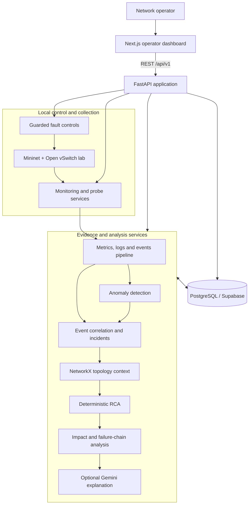
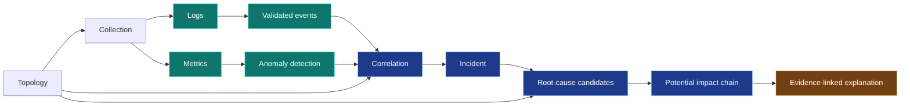

# NetRCA

**Evidence-grounded network incident analysis for controlled labs and pilot environments.**

[](backend/)
[](frontend/)
[](database/)
[](network/)
[](#project-status)

NetRCA is an AI-assisted network root cause analysis and incident investigation system. It brings topology, metrics, logs, events, anomalies, incident correlation, deterministic root-cause candidates, failure chains, and potential impact into one traceable workflow. Every analytical conclusion is designed to remain connected to its original evidence.

The repository contains a working local dashboard, a FastAPI backend, PostgreSQL/Supabase persistence, an isolated Mininet laboratory, deterministic analysis services, and an optional Gemini explanation layer. It also includes a browser-only synthetic scenario for reliable demonstrations without Docker, a database seed, Mininet, customer data, or a live Gemini request.

> [!IMPORTANT]
> NetRCA is currently suitable for development, academic demonstration, and a controlled customer pilot. It is not yet a finished multi-tenant production service. See [Commercial readiness](#commercial-readiness) for the remaining gates.

## Contents

- [Problem and approach](#problem-and-approach)
- [Core capabilities](#core-capabilities)
- [System architecture](#system-architecture)
- [Evidence and analysis flow](#evidence-and-analysis-flow)
- [Quick presentation setup](#quick-presentation-setup)
- [Standard local setup](#standard-local-setup)
- [Configuration and safety](#configuration-and-safety)
- [API overview](#api-overview)
- [Testing](#testing)
- [Repository structure](#repository-structure)
- [Project status](#project-status)
- [Commercial readiness](#commercial-readiness)

## Problem and approach

Network incidents rarely arrive as one clear failure. Operators typically receive disconnected symptoms—packet loss, latency spikes, interface transitions, timeouts, and service alerts—and must manually reconstruct the sequence across multiple tools.

NetRCA turns those observations into a structured investigation:

1. Collect validated topology and telemetry.
2. Preserve metrics, logs, and events as original evidence.
3. Detect threshold and model-supported anomalies.
4. Correlate only evidence with explicit shared identities and supported relationships.
5. Build incident records without duplicating evidence membership.
6. Rank deterministic root-cause candidates and retain supporting or contradictory evidence.
7. Trace observed and potential impact separately.
8. Optionally ask Gemini to summarize the validated result; the model does not replace the deterministic analysis.

## Core capabilities

| Capability | What NetRCA provides |
| --- | --- |
| Network laboratory | Controlled Mininet and Open vSwitch topology with guarded lifecycle and fault operations |
| Topology engine | Stable device/link identities, endpoint validation, component detection, paths, neighbors, and importance analysis |
| Monitoring | Read-only device, interface, link, and connectivity observations |
| Evidence pipeline | Validated metrics, logs, events, timestamps, source identities, and deduplication |
| Fault injection | Explicitly enabled lab-only link failure, interface failure, latency, and packet-loss scenarios |
| Anomaly detection | Deterministic thresholds with optional Isolation Forest support when sufficient history exists |
| Incident correlation | Configurable time windows plus direct device, link, service, and topology relationships; time proximity alone is insufficient |
| Explainable RCA | Rule-scored candidates with evidence references, contradictions, limitations, and inconclusive outcomes |
| Impact analysis | Failure-chain traversal that distinguishes observed facts from potential downstream impact |
| AI explanation | Opt-in Gemini narrative built from validated evidence and analysis; never an authority for network control |
| Operator dashboard | Responsive overview, topology, evidence, anomaly, incident, and demonstration views |
| Persistence | PostgreSQL/Supabase migrations, RLS, transactional repositories, and rollback-oriented integration tests |

## System architecture



The backend is the trust boundary. Browser code receives only public configuration, while database credentials and the Gemini key remain server-side. Network-changing operations are local-only, require explicit feature flags, and use the established control header.

## Evidence and analysis flow



NetRCA treats correlation as relationship discovery—not proof of causation. RCA scores are uncalibrated rule points, not probabilities. Missing, stale, malformed, unrelated, or unsupported evidence remains excluded or produces an explicit inconclusive result.

## Quick presentation setup

The fastest way to demonstrate the complete workflow is the synthetic presentation mode. It requires no Docker image, database seed, Mininet process, remote write, or Gemini call.

### Prerequisites

- Windows PowerShell
- Python 3.11 or newer
- Node.js 20 or newer and npm
- Backend virtual environment and frontend dependencies installed once

### One-time installation

```powershell
cd backend
py -m venv .venv
.\.venv\Scripts\Activate.ps1
python -m pip install -r requirements-dev.txt

cd ..\frontend
npm ci
cd ..
```

### Start and stop

```powershell
.\scripts\start-presentation.ps1
```

Open `http://127.0.0.1:3000` if the browser does not open automatically. The interface is clearly labeled **Synthetic demo** and includes a sample WAN outage, stored topology, metrics, logs, events, anomalies, an incident, an RCA candidate, and a potential impact chain.

```powershell
.\scripts\stop-presentation.ps1
```

Use the [presentation runbook](PRESENTATION.md) for the five-minute narrative and the [reusable pitch deck](presentation.pptx) for a formal product presentation.

## Standard local setup

### 1. Backend

```powershell
cd backend
py -m venv .venv
.\.venv\Scripts\Activate.ps1
python -m pip install -r requirements-dev.txt
Copy-Item .env.example .env
python -m uvicorn app.main:app --reload --host 127.0.0.1 --port 8000 --no-proxy-headers
```

Backend endpoints:

- Health: `http://127.0.0.1:8000/api/v1/health`
- Swagger UI: `http://127.0.0.1:8000/docs`
- OpenAPI: `http://127.0.0.1:8000/openapi.json`

On Linux or WSL2, activate the environment with `source .venv/bin/activate` and copy the example with `cp .env.example .env`.

### 2. Frontend

In a second terminal:

```powershell
cd frontend
npm ci
Copy-Item .env.example .env.local
npm run dev
```

Open `http://localhost:3000`. The default frontend API address is `http://localhost:8000/api/v1`.

### 3. Database-backed workflows

Add the required server-side values to `backend/.env`, review the migration state, and verify the connection from `backend/`:

```powershell
python -m app.db.check
```

Migration and rollback guidance is maintained in [database/README.md](database/README.md). Never apply migrations to an ambiguous target, place credentials in the frontend, or seed the linked/cloud database with demonstration data.

### 4. Mininet laboratory

Mininet requires a supported Linux environment, Open vSwitch, and elevated network privileges. Windows runs the dashboard and API, while WSL2/Ubuntu can host the isolated lab. Follow [network/README.md](network/README.md) for environment checks, lifecycle commands, smoke tests, and cleanup verification.

Docker is not required for the synthetic presentation mode or the standard Windows dashboard/backend workflow. It is only relevant if you intentionally choose a container-based local database or deployment workflow.

## Configuration and safety

The backend reads `backend/.env`; the frontend reads `frontend/.env.local`. Example files contain no credentials.

| Variable | Scope | Purpose |
| --- | --- | --- |
| `NEXT_PUBLIC_API_BASE_URL` | Frontend | Browser-visible API base URL including `/api/v1` |
| `NEXT_PUBLIC_NETRCA_PRESENTATION_MODE` | Frontend | Enables the explicitly labeled browser-only synthetic fixture |
| `NETRCA_CORS_ORIGINS` | Backend | Exact browser origins allowed to access the API |
| `DATABASE_URL` | Backend | PostgreSQL connection string; server-side only |
| `SUPABASE_URL` | Backend | Supabase project URL |
| `SUPABASE_PUBLISHABLE_KEY` | Backend | Publishable Data API key; not a database password |
| `GEMINI_API_KEY` | Backend | Gemini credential; server-side only |
| `NETRCA_SIMULATION_ENABLED` | Backend | Opts in to the controlled Mininet lifecycle |
| `NETRCA_PIPELINE_WRITES_ENABLED` | Backend | Opts in to evidence persistence |
| `NETRCA_FAULT_INJECTION_ENABLED` | Backend | Opts in to lab-only fault controls |
| `NETRCA_ANOMALY_WRITES_ENABLED` | Backend | Opts in to anomaly persistence |
| `NETRCA_CORRELATION_WRITES_ENABLED` | Backend | Opts in to incident correlation writes |
| `NETRCA_RCA_WRITES_ENABLED` | Backend | Opts in to RCA persistence |
| `NETRCA_IMPACT_WRITES_ENABLED` | Backend | Opts in to impact persistence |
| `NETRCA_GEMINI_ENABLED` | Backend | Enables the explicit Gemini explanation action |

All network-changing and write paths are disabled by default. Protected local-control routes require `X-NetRCA-Local-Control: 1` in addition to their corresponding feature flag. Do not expose the development API or dashboard to a LAN or the public internet; this build does not yet provide end-user authentication.

## API overview

All application routes are under `/api/v1`.

| Area | Representative routes |
| --- | --- |
| Health | `GET /health` |
| Network | `GET /network/status`, `POST /network/start`, `POST /network/stop` |
| Topology | `GET /topology`, `GET /topology/analysis`, `GET /topology/path` |
| Monitoring | `GET /network/monitoring`, `POST /network/monitoring/probe` |
| Evidence | `GET/POST /metrics`, `GET/POST /logs`, `GET/POST /events` |
| Faults | `GET /faults`, `POST /faults/inject`, `POST /faults/{id}/recover` |
| Anomalies | `POST /anomalies/detect`, `GET /anomalies` |
| Incidents | `POST /events/correlate`, `GET /incidents`, `GET /incidents/{id}` |
| RCA | `POST /incidents/{id}/root-cause/analyze`, `GET /incidents/{id}/root-causes` |
| Impact | `POST /incidents/{id}/impact/analyze`, `GET /incidents/{id}/failure-chain` |
| Explanation | `POST /ai/incidents/{id}/explain` |

The generated Swagger UI is the authoritative runtime reference for request and response schemas.

## Testing

### Windows backend

```powershell
cd backend
.\.venv\Scripts\python.exe -m pytest
```

### Frontend

```powershell
cd frontend
npm test
npm run typecheck
npm run lint
npm run build
```

### PostgreSQL integration

Database integration suites are opt-in and require an explicitly configured test database. Follow the relevant phase report and use rollback transactions where supported. Do not replace database integration evidence with mocks.

### WSL2 and Mininet

Run the network suites only inside the isolated Linux lab and verify cleanup afterward. Exact commands and environment requirements are in [network/README.md](network/README.md).

## Repository structure

```text
backend/       FastAPI routes, services, repositories, models, and pytest suites
frontend/      Next.js dashboard, API client, topology visualization, and Vitest tests
supabase/      Versioned PostgreSQL migrations and Supabase CLI configuration
database/      Database setup, verification, rollback, and local fixture guidance
network/       Mininet/Open vSwitch laboratory and lifecycle validation
topology/      Topology engine and NetworkX graph-analysis documentation
monitoring/    Read-only network monitoring implementation and report
pipeline/      Metrics, logs, events, and evidence persistence
faults/        Controlled fault-injection implementation and safeguards
anomaly/       Deterministic and optional ML anomaly detection
correlation/   Event correlation and incident grouping
rca/           Explainable deterministic root-cause analysis
impact/        Impact and failure-chain analysis
explanation/   Evidence-grounded Gemini explanation contract
audit/         Cross-phase verification and correction reports
Instruction/   Original architecture, SRS, PRD, security, ERD, API, and stack documents
scripts/       Repeatable local presentation start/stop commands
```

## Project status

The implemented foundation covers the planned investigation path from controlled network observations through an operator-facing explanation:

```text
Mininet / stored topology
        → monitoring and evidence
        → anomaly detection
        → event correlation
        → incident grouping
        → graph context
        → deterministic RCA
        → impact and failure chain
        → optional Gemini explanation
        → responsive dashboard
```

The project has separate Windows, PostgreSQL, and WSL2/Mininet validation paths. A passing API health request confirms only that FastAPI responded; database availability, simulator availability, and analysis persistence are reported independently.

Detailed implementation reports are available beside each subsystem, including:

- [Phase 3 network report](network/PHASE3_REPORT.md)
- [Phase 8 anomaly report](anomaly/PHASE8_REPORT.md)
- [Phase 9 correlation report](correlation/PHASE9_REPORT.md)
- [Phase 11 RCA report](rca/PHASE11_REPORT.md)
- [Phase 12 impact report](impact/PHASE12_REPORT.md)
- [Phase 13 explanation report](explanation/PHASE13_REPORT.md)
- [Phase 16 frontend integration report](frontend/PHASE16_REPORT.md)
- [Phase 17 topology report](frontend/PHASE17_REPORT.md)
- [Phase 14–18 audit](audit/PHASE14-18_AUDIT_REPORT.md)

## Commercial readiness

NetRCA can be presented today as a working technical prototype and the basis for a controlled pilot. Before offering it as a production multi-tenant service, the following work remains:

- tenant-aware authentication, authorization, and SSO;
- customer-specific data isolation and audit actor identity;
- managed deployment, secret rotation, backup, restore, and disaster recovery;
- production observability, performance/load testing, and service-level objectives;
- dependency security remediation and independent penetration testing;
- approved integrations with customer telemetry sources;
- operational support, licensing, privacy, and data-retention agreements.

The recommended commercial path is to connect one approved lab or read-only telemetry source, validate the evidence model and operator workflow with the customer, and then harden tenancy and deployment around the proven use case.

## Documentation

The original specifications remain unchanged in [`Instruction/`](Instruction/). They define the architecture, API design, security model, ERD, technical stack, product requirements, and software requirements. Current migrations and implementation reports document the delivered behavior where the implementation has evolved from the original plan.
